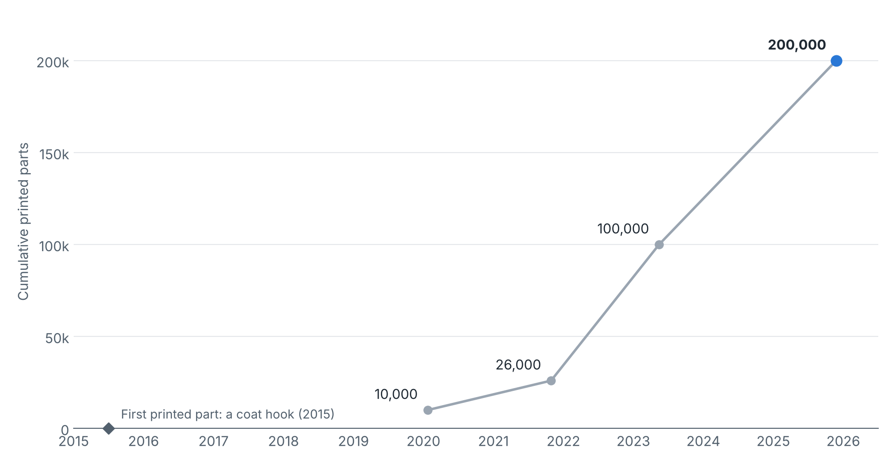
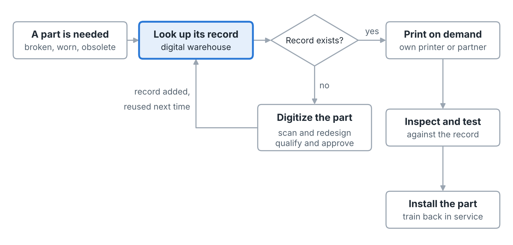

# Deutsche Bahn spare parts — AM workshop plan

EXED Polytechnique — Additive Manufacturing — 04 Industries, by Andrei Constantinescu 2027.
Version of 26 Nov 2026. Editable source: claude.ai doc “DB Spare Parts — AM Workshop Plan”.
Data: [`tables/04_rl_db_milestones.csv`](tables/04_rl_db_milestones.csv). Figures: [`figures/`](figures/) (Python source next to each PNG).
The facilitator answer keys are kept out of this public repository.

## Overview

A one-day (or two half-day) workshop that uses Deutsche Bahn's spare-parts programme to teach when, why and how additive manufacturing (AM) pays off. It works for a mixed audience because everyone knows trains and the numbers are public.

**Audience:** engineering students, maintenance and procurement staff, managers — no AM background needed. Groups of 4–5, mixed by background.

**Learning outcomes.** By the end, participants can:

1. Explain the digital-warehouse logic: store files, print on demand, instead of stocking parts.
2. Screen a list of parts and pick sensible AM candidates using simple criteria.
3. Match a part to an AM process (extrusion, powder-bed fusion, binder jetting) and material.
4. Build a rough cost and lead-time case against conventional sourcing.
5. Plan the steps to digitize an obsolete part: reverse engineering, redesign, qualification, approval.

## Case fact sheet

Hand this out at the start. Every figure below was checked against a public source.

| Milestone | What DB reported | Source |
| --- | --- | --- |
| 2015 | First printed spare parts — simple plastic items such as a coat hook | [Manufactur3D](https://manufactur3dmag.com/db-3d-printing-milestone-100000-parts/) |
| May 2023 | 100,000th part: a gearbox housing for shunting locomotives, cast in a binder-jetted sand mould; over 500 applications | [Global Railway Review](https://globalrailwayreview.com/?p=144352), [Logistik Heute](https://logistik-heute.de/news/instandhaltung-deutsche-bahn-schafft-die-marke-von-100-000-3d-gedruckten-ersatzteilen-40139.html) |
| May 2023 | Digital warehouse ~1,000 virtual models; target ~10,000 by 2030, about 10 % of parts used in vehicle maintenance | [CIO.de](https://www.cio.de/article/3696020/deutsche-bahn-nutzt-3d-druck-fuer-immer-mehr-ersatzteile.html) |
| Nov 2025 | 200,000+ printed parts in service; savings above EUR 20 M since 2015; 1,000+ applications | [DB press release](https://www.deutschebahn.com/de/presse/pressestart_zentrales_uebersicht/10-Jahre-3D-Druck-bei-der-DB-Immer-mehr-Ersatzteile-und-Spezialwerkzeuge-per-Mausklick-verfuegbar-13638280), [Railway News](https://railwaynews.net/germanys-db-200000-3d-printed-rail-parts-e20m-saved.html) |
| Nov 2025 | 12 AM processes (incl. material extrusion, powder-bed fusion, binder jetting) in plastic, metal and sand; largest metal part a 540 kg gearbox housing | [DB press release](https://www.deutschebahn.com/de/presse/pressestart_zentrales_uebersicht/10-Jahre-3D-Druck-bei-der-DB-Immer-mehr-Ersatzteile-und-Spezialwerkzeuge-per-Mausklick-verfuegbar-13638280) |

**Other useful details:** the printed gearbox housing cut lead time to about two months, and supports roughly 370 shunting locomotives. DB prints in-house but relies mostly on a partner network of 140+ organisations (“Mobility goes Additive”, founded by DB in 2016).

**Correction to note:** the ~1,000-model warehouse and the 10,000-by-2030 target date from 2023, not 2015. In 2015 DB started with single parts like the coat hook.

## Workshop agenda

Morning builds the toolkit; the afternoon applies it to the “digitize obsolete spare parts” scenario. Total about 6 hours of contact time.

| Time | Block | Format | Exercise |
| --- | --- | --- | --- |
| 09:00 – 09:20 | Hook: “Your train is stuck for want of a coat hook” | Plenary | Ex. 1 |
| 09:20 – 10:00 | DB story 2015 → 2025 and the digital-warehouse idea | Lecture + fact sheet | — |
| 10:00 – 10:45 | Which parts should we print? | Groups | Ex. 2 |
| 10:45 – 11:00 | Break | — | — |
| 11:00 – 12:00 | AM processes and materials, matched to DB parts | Lecture + groups | Ex. 3 |
| 12:00 – 13:00 | Lunch | — | — |
| 13:00 – 13:45 | Does it pay? Cost and lead-time case | Groups, spreadsheet or paper | Ex. 4 |
| 13:45 – 15:15 | Scenario: digitize obsolete spare parts | Groups | Ex. 5 |
| 15:15 – 15:45 | Pitches: each group presents its plan in 3 minutes | Plenary | Ex. 5 |
| 15:45 – 16:00 | Debrief and exit ticket | Plenary | Ex. 6 |

**Half-day version:** keep Ex. 1, 2 and 5; give Ex. 3–4 results as handouts.

## Talk script: the DB story and the digital warehouse (40 min)

One message to land: **DB stores files instead of parts, and prints when a part is needed.** The story shows it started small, grew fast, and pays off through avoided downtime more than cheaper parts.

| Min | Segment | What to say | Slide / prop |
| --- | --- | --- | --- |
| 0–5 | Hook | A train can sit idle for want of a small part the maker no longer produces. Ask: “How long would you wait for a spare for a 30-year-old train?” Collect guesses. | A photo of a coat hook — reveal it was DB's first printed part |
| 5–12 | The problem | Rail vehicles run for decades, but suppliers stop making parts. Options are bad: buy a large minimum order and store it, pay for new tooling, or wait months. Meanwhile the vehicle earns nothing. | Simple sketch: long vehicle life vs short supplier support |
| 12–22 | The story, 2015 → 2025 | Walk the timeline on the fact sheet: 2015 coat hook; May 2023 the 100,000th part, a 500+ kg gearbox housing cast in a printed sand mould, lead time cut to about two months; Nov 2025 200,000+ parts, EUR 20 M+ saved, 1,000+ applications, 12 processes, a 540 kg housing. Mention new-train use too: a printed template speeds ICE L fit-out. | Timeline slide; one photo per milestone |
| 22–32 | The digital-warehouse idea | Compare the two warehouses (table below). Then the flow: a part is needed → look up its record → print in-house or at a partner → inspect → install. Stress that the record is more than a CAD file. DB prints mostly via 140+ partners, so the file travels, not the part. | Two-column comparison; flow arrows |
| 32–37 | Honest limits | Not every part qualifies: safety-critical, high-volume parts stay conventional. Approval and testing take longer than printing. Average saving is only about EUR 100 per part, so the value is downtime and stock, not unit price. Open questions: who owns the file, who is liable. | “What AM is not” slide |
| 37–40 | Bridge to Ex. 2 | “DB has ~1,000 models and wants ~10,000 by 2030. If you had to pick the next ones, which would you choose?” Hand out the part cards. | Ex. 2 part cards |

**Slide for minutes 12–22: the growth curve**

*From one coat hook in 2015 to over 200,000 printed parts in 2025. Source: DB press releases and reports quoting them, Jan 2020 – Nov 2025; DB reports each count as “more than”.*

Five slow years, then a steep climb from 2021. Ask the room why before you explain.

**Physical vs digital warehouse (for minutes 22–32):**

| | Physical warehouse | Digital warehouse |
| --- | --- | --- |
| What is stored | Parts on shelves | Files plus their records |
| Cost of holding | Space, capital, scrap of unused parts | Data management and qualification |
| When the maker stops | Stock runs out | Print again from the file |
| Lead time | Fast if in stock; months if not | Days to weeks, any time |
| Where | One location, then shipped | Any approved printer or partner |

**Slide for minutes 22–32: the flow**

*Files, not shelves: a part is printed on demand, or digitized once.* The slow, expensive step is digitizing a part the first time; after that every depot reuses the record.

**What a digital-warehouse record holds:** the 3D model, material, AM process and parameters, post-processing steps, inspection criteria, test results, approval status and revision. Ask the room which of these they would forget — usually the parameters and approval status.

**Questions to keep the room awake:** after the timeline, “Why start with a coat hook?”; after the warehouse table, “What could go wrong if a partner prints from an old revision?”

## Exercises

Six exercises, ordered from quick estimates to the full scenario. Cost figures in Ex. 4 and 5 are invented for teaching; DB figures come from the fact sheet.

### Ex. 1 — Napkin numbers (15 min, pairs)

Give students this data card so everyone works from the same numbers. Each figure is DB's own, taken from a DB press release or a report quoting one; students should state any extra assumption they add.

| Date | Printed parts (cumulative) | Applications | Source |
| --- | --- | --- | --- |
| Nov 2025 | 200,000+ | 1,000+ | [DB press release](https://www.deutschebahn.com/de/presse/pressestart_zentrales_uebersicht/10-Jahre-3D-Druck-bei-der-DB-Immer-mehr-Ersatzteile-und-Spezialwerkzeuge-per-Mausklick-verfuegbar-13638280) |
| May 2023 | 100,000 | 500+ | [Manufactur3D](https://manufactur3dmag.com/db-3d-printing-milestone-100000-parts/) |
| Oct 2021 | 26,000+ | 300 | [Railway-News](https://railway-news.com/deutsche-bahn-is-getting-into-industrial-3d-printing-for-faster-easier-train-maintenance) |
| Jan 2020 | 10,000+ | 130+ | [DB press release, hosted by TRUMPF](https://www.trumpf.com/filestorage/TRUMPF_de_DE/Unternehmen/Pressemitteilungen/20200123-PM-3D-Druck-bringt-Zuege-schneller-wieder-auf-die-Schiene/20200123-PM-3D-Druck-bringt-Zuege-schneller-wieder-auf-die-Schiene.pdf) |
| 2015 | first parts (coat hook) | — | DB press release, Nov 2025 |

**Other inputs:** savings above EUR 20 M since 2015 (Nov 2025). Digital warehouse: about 1,000 models in 2023, still “over 1,000” in Nov 2025; target about 10,000 by 2030. ICE 1 refurbishment (2021): a printed stencil cuts gluing one seat number from 8 to 3 minutes, for about 8,700 seat numbers on 58 trains.

Questions:

1. What is the average saving per printed part? Is that a lot or a little — why?
2. DB went from 100,000 to 200,000 parts between May 2023 and Nov 2025. What does that say about adoption?
3. Going from ~1,000 to ~10,000 models between 2023 and 2030: how many new models per year? What annual growth rate?
4. Why might a cheap coat hook be the right *first* part, even if it saves almost nothing?

**Bonus questions:**

- DB reported about 730 hours saved with the stencil. Check that figure from the data card.
- The warehouse held about 1,000 models in 2023 and “over 1,000” in late 2025. Is the 10,000-by-2030 target on track? What would have to change?

### Ex. 2 — Which parts should we print? (45 min, groups)

Score each part 1–3 on four criteria, then pick your top three and one clear “no”.

- **Sourcing pain:** obsolete, long lead time, or high minimum order?
- **Volume:** low and irregular demand favours AM.
- **Risk class:** safety-critical parts need far more qualification.
- **Technical fit:** size, material and tolerances AM can meet today.

| Part | Material | Notes given to groups |
| --- | --- | --- |
| Coat hook | Plastic | Broken often by passengers; OEM part discontinued |
| Ventilation grille, passenger area | Plastic | Must meet rail fire standards |
| Wheelset bearing cover, shunting loco | Steel | Small batches; supplier slow |
| Gearbox housing, shunting loco | Cast steel/iron, 500+ kg | OEM no longer makes it; locos stand idle without it |
| Brake disc | Cast iron | Wears regularly; high volumes; safety-critical |
| Seat headrest clip | Plastic | Thousands per year; cheap moulded part available |
| Assembly template for fitting pictograms | Plastic | Tool, not a train part; used during fit-out |
| Wheel | Forged steel | Safety-critical; high load; standardised supply |

### Ex. 3 — Match the process (30 min, groups)

For each of your top-three parts, choose a process and material and justify it in one line. Options: material extrusion (FDM / high-speed extrusion), polymer powder-bed fusion (SLS/MJF), metal laser powder-bed fusion, binder jetting of sand moulds then casting (“indirect AM”), directed energy deposition / WAAM. Add one post-processing step and one test you would require.

### Ex. 4 — Does it pay? (45 min, groups)

An obsolete plastic cover. Demand: 5 per year for 10 years (50 total).

| | Conventional re-tooling | AM on demand |
| --- | --- | --- |
| One-off cost | EUR 3,000 mould | EUR 1,500 reverse engineering + approval |
| Unit cost | EUR 40, minimum order 50 | EUR 65 |
| Per-order setup | — | EUR 100 per yearly print job |
| Storage | EUR 2 per unit per year | none (file only) |
| Lead time | 6 months | 2 weeks |

1. Compute the 10-year cost of each option. Assume the conventional stock drains evenly.
2. A vehicle waiting for this part costs EUR 400 per day out of service. How many days of waiting makes AM the cheaper choice?
3. What happens to your answer if the part is redesigned and the fleet is retired after 5 years?
4. Name two costs this table leaves out.

### Ex. 5 — Scenario: digitize obsolete spare parts (90 min + pitch)

**Situation.** A regional operator runs 60 ageing multiple units. The OEM for the door-control housing has closed. No drawings exist, 3 spares remain, and 2 units fail per month. Your task: bring the part into the digital warehouse.

**Roles (one per person):** maintenance engineer, AM specialist, buyer, safety and approval officer, fleet manager.

**Deliverables (one flipchart + 3-minute pitch):**

1. Process chain from broken part to approved file, with owner and duration per step.
2. Process and material choice, with one redesign improvement.
3. Qualification plan: what you test, against which requirements, who signs off.
4. Rough cost and lead-time comparison (reuse Ex. 4 logic).
5. Top three risks and how you reduce them.
6. What goes into the digital-warehouse record so another depot can print it.

**Twist cards (hand one per group at minute 45):** the scanned part turns out to be worn and out of tolerance; the file must be shared with an external print partner, so who owns the IP?; the approval officer requires fire-safety proof; the original material is no longer available.

### Ex. 6 — Exit ticket (10 min, individual)

1. One part in *your* field you would put in a digital warehouse, and why.
2. The biggest barrier to doing it.
3. One thing that surprised you today.

## Facilitator notes

Answer keys for Ex. 1–4 and the Ex. 5 debrief questions are in the instructor copy (claude.ai doc), not in this repository.

**Materials:**

- Printed fact sheet and part cards for Ex. 2 (one set per group)
- Calculators or a shared spreadsheet for Ex. 4
- Flipcharts, markers, role cards and twist cards for Ex. 5
- Optional: a few 3D-printed sample parts and one conventional part to pass around

## Illustrations: where to get them

The best images are DB's own press photos, credited “DB AG / photographer”. Use them with that credit on the slide. DB provides its photo material for journalistic use, so for slides you publish or hand out widely, ask DB's press office (presse@deutschebahn.com) first. **None of these photos is stored in this repository.**

| Image | Where | Credit |
| --- | --- | --- |
| 540 kg gearbox housing; yellow ICE L template | [DB press release, Nov 2025](https://www.deutschebahn.com/de/presse/pressestart_zentrales_uebersicht/10-Jahre-3D-Druck-bei-der-DB-Immer-mehr-Ersatzteile-und-Spezialwerkzeuge-per-Mausklick-verfuegbar-13638280) | DB AG; DB AG / Max Zimmermann |
| Gearbox housing from indirect printing; model of the printed sand mould | [DB press release, May 2023](https://www.deutschebahn.com/de/presse/pressestart_zentrales_uebersicht/3D-Druck-bringt-Zuege-schneller-aufs-Gleis-10641506) | DB AG / Dominic Dupont; DB AG / Susanne Tost |
| Large-format printers in DB workshops | [Railway-News, Oct 2021](https://railway-news.com/deutsche-bahn-is-getting-into-industrial-3d-printing-for-faster-easier-train-maintenance) | DB AG / Oliver Lang |
| Metal printer making a mould for an ICE part | [DB press release via TRUMPF, Jan 2020](https://www.trumpf.com/filestorage/TRUMPF_de_DE/Unternehmen/Pressemitteilungen/20200123-PM-3D-Druck-bringt-Zuege-schneller-wieder-auf-die-Schiene/20200123-PM-3D-Druck-bringt-Zuege-schneller-wieder-auf-die-Schiene.pdf) | as stated in the release |
| More DB photos by keyword (“3D-Druck”) | [DB Mediathek](https://mediathek.deutschebahn.com/) | as stated per image |

**Other routes:**

- **Diagrams drawn for the course:** the growth curve and the warehouse flow above (`figures/`). No rights issues.
- **Your own photos:** printed sample parts from the lab, next to a conventional part. Often the most memorable slide.
- **Generic train photos:** Wikimedia Commons, checking the licence and credit line of each image.
- **Partners:** printer makers and the Mobility goes Additive network publish case photos; ask before reuse.
